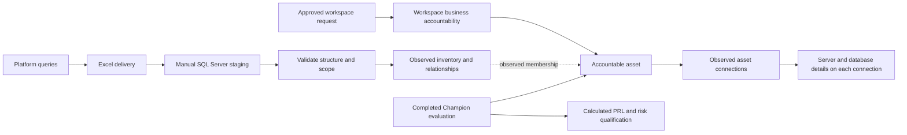

> **Earlier local workflow snapshot.** The [V1.2 guide](v1.2-guide.md) is the current product and workflow entry point. This V1.1 snapshot remains unchanged for traceability.

# V1.1 approved local workflows

20 October 2026. Local prototype; no new GitHub publication.

This document records the implemented decisions from the page reviews. It supersedes older workflow descriptions that require asset approval or manually approved PRL. Frozen release documents remain historical references.

## Purpose and audience

Analytic Registry combines observed platform facts with declared business accountability. Business users maintain context and complete their assigned work. Platform teams supply evidence and resolve technical exceptions.

The prototype uses browser storage and fictional records. Its controls model the agreed process. Production authentication, SQL transactions, recurring imports, and retention jobs remain integration work.

## Information ownership

| Information | Authority | What refresh can change |
|---|---|---|
| Native IDs, names, membership, connections, source roles | Platform observations | Validated source facts, with their original observation dates |
| Workspace Owner, equal Champions, purpose, business line, content declarations | Approved workspace request | Only the approved business change, on its effective date |
| Accountable workspace for an asset | Confirmed business association | Initial Champion confirmation or documented Platform Manager transfer |
| Asset business purpose, audience, version, governance answers | Completed Champion evaluation | Current business context only from an eligible current-version evaluation |
| PRL and High risk qualification | Versioned PRL-01 rules | Calculated from recorded answers |
| Findings and Review cases | Existing evidence and work records | No automatic closure from a refresh, association change, or high-risk result |

Names, email, source revision, and delivery date are not object identities. A Registry ID remains separate from a platform-native identity.

The diagram shows the intended production boundary. The local app contains comparison examples and business workflow commands. It does not connect the SQL staging area to browser records.

## Pages and actions

Five primary sections remain: Dashboard, Workspaces, Assets, Requests, and My work. Administration contains Platform imports and reference tools.

| Page | Essential content | Main actions |
|---|---|---|
| Workspace list | Workspace, platform, Workspace Owner, registration/lifecycle, next action | Open work; register a discovered workspace |
| Workspace detail | Overview; Assets & connections; Access & configuration; Work; History | Request change; inspect evidence and open work |
| Asset list | Asset, platform, accountable workspace, Governance & risk, next action | Open the record or confirm accountability |
| Asset detail | Overview; Connections; Governance & risk; Work | Record a completed evaluation; confirm or transfer accountability |
| Requests | Business intent and separate technical milestones | Create, register, update, approve, record external work |
| Platform imports | Receive; Validate; Match; Compare; Accept | Review query references and synthetic refresh examples |

Retired workspaces are hidden by default. “Include retired” changes visibility only. No retirement or restoration operation was added.

The workspace business line is declared independently. Directory business-line information remains context. Unconfirmed legacy values stay visibly unconfirmed.

## Workspace requests

1. Select the workspace and confirm business responsibility.
2. Declare PII, EUCT, and the highest applicable DMP tier.
3. When technical changes are requested, complete Setup and Groups & access.
4. Review and submit the request.
5. Record required decisions and external implementation evidence.

The interface shows three steps for business-only existing-workspace requests and five for technical requests.

One current eligible Champion approves business declarations, the Workspace Owner, and the Champion roster. Initial setup can use an active, verified proposed Champion when no effective roster exists.

All Champions have equal authority. A proposed replacement cannot approve their own appointment in an already governed workspace. Eligible self-approval remains allowed.

Business users can record their own eligible Champion decision. Administrator view can simulate other eligible approvers for local testing. Production role checks must run on the server.

Custom configuration retains Application Owner or Platform Owner approval. Applicable technical work retains Platform Administrator approval. Missing eligible Champions route to Platform Manager without granting substitute approval authority.

Business-only changes do not create configuration versions or groups. A technical request can remain open after approved business responsibility becomes effective.

Standard technical setup retains Champion, RW, R, and Data Sources groups. The `_DS` group authorizes connection creation and maintenance, subject to supported platform roles. Champion status does not grant platform access.

Historical requests retain their original approval policy and receipts. New requests use `champion-v1`.

## Asset governance and versions

Only a current, active, verified Champion of the accountable workspace can record a completed evaluation. The recorder is the acting user.

Evaluations use four steps: Business context, PRL inputs, Governance, and Evidence & save. They have no saved draft, separate approval queue, or asset Annual Attestation.

| PRL input | PRL 3 band | PRL 2 band | PRL 1 band |
|---|---|---|---|
| Calculation or transformation complexity | Simple | Moderate | Complex |
| Distinct logical sources | 0–3 | 4–10 | 11 or more |
| Intended human audience | 0–50 | 51–500 | 501 or more |

The most demanding applicable answer determines PRL. A known PRL 1 condition is conclusive. Otherwise, an unknown applicable answer leaves PRL Not determined. Automated use can exclude human audience size with a recorded reason.

Row-level security, processing mode, dataset size, and execution duration provide context. They do not change PRL-01.

High risk means **PRL 1 OR PII Yes OR EUCT Yes OR DMP Tier 1, 2, or 3**. Tier 1 is the highest DMP tier.

Untiered is an explicit answer. It is not Unknown. “Does not meet the High risk rule” requires all necessary answers to rule out every qualifying condition.

High risk is a qualification, not a failed control. Saving it does not create a Review case automatically.

| Change | Version treatment |
|---|---|
| Material purpose, business logic, result meaning, data use, or intended consumers | New business version and completed evaluation |
| Equivalent material technical change | New evaluation of the same version |
| Corrected declaration | New evaluation of the same version; preserve the prior entry |
| Routine refresh, source revision, rename, presentation-only change | No automatic business version |
| Historical evidence | Keep it in history; do not replace current context |

A new business version becomes current only when its completed evaluation saves successfully. The version, evaluation, and current references save together.

## Asset accountability

A current Champion of the proposed registered workspace confirms an initial association. The platform must match the asset's platform.

Platform Manager records an existing transfer or correction. The record needs a reason and traceable business confirmation from the affected workspaces.

An association change preserves native membership evidence, earlier evaluations, and existing cases. Unresolved confirmation leaves the current association unchanged.

## Data structures added or clarified

The runtime retains multiple related record collections. It does not flatten source evidence and business declarations into one table.

| Collection or field | Type | Purpose |
|---|---|---|
| `Workspace.businessLineStatus` | Optional choice: Declared, Inherited, Unknown | Distinguishes a declared business line from legacy context |
| `WorkspaceRequest.approvalPolicy` | Optional choice: champion-v1 | Selects the new policy; absent on preserved legacy requests |
| `WorkspaceRequest.workspaceBusinessLine` | Optional text; required by new policy | Captures the independently declared business line |
| `Asset.currentBusinessVersionId` | Optional ID | References the current business version |
| `Asset.currentEvaluationId` | Optional ID | References the current eligible completed evaluation |
| `Asset.nativeType` | Optional text | Preserves a known native type without inferring missing facts |
| `Asset.nativeVersionReference` | Optional text | Keeps source revision separate from business version |
| `Asset.governanceRisk` | Optional risk choice | Stores the projected current evaluation result |
| `assetBusinessVersions` | Related records | One asset's explicit business versions |
| `assetEvaluations` | Related records | Completed evidence, answers, calculated result, actor, version, and dates |
| `assetAssociations` | Related records | Confirmed accountable workspace changes and their evidence |

`AssetBusinessVersion` columns are `id`, `assetId`, `reference`, `origin`, optional `declaredAt`, `declaredById`, `evaluationId`, and `previousVersionId`. IDs and references are text; dates are ISO timestamps. `origin` is a controlled choice.

`AssetGovernanceEvaluation` stores `id`, `assetId`, `businessVersionId`, `version`, `workspaceId`, `reviewerId`, `evaluatedOn`, `recordedAt`, `purpose`, `audience`, `answers`, `methodVersion`, `calculatedPrl`, `risk`, `qualificationReasons`, `evidenceReference`, `comments`, `externalWorkReference`, `changeKind`, `mode`, and optional `previousEvaluationId`.

IDs and narrative fields are text. `evaluatedOn` is a calendar date; `recordedAt` is an ISO timestamp. Answers are typed choices or nonnegative integer counts. Qualification reasons are text values. Method, PRL, risk, change kind, and mode are controlled choices.

`AssetAssociationRecord` stores text IDs `id`, `assetId`, nullable `previousWorkspaceId`, `workspaceId`, and `actorId`. `recordedAt` is the effective recording timestamp. `reason` and `confirmationReference` are text. `kind` distinguishes Initial confirmation from Transfer or correction.

The logical `ObjectObservation` catalog now includes nullable `ServerHostname`, `DatabaseName`, and `AuthenticationTypeCode`. They stay with each connection. A shared cross-platform DataSource entity remains deferred.

Legacy assessments remain intact. No migration fabricates approval evidence, actors, source revisions, or observed membership.

## Import and identity requirements

Alteryx queries use SQL Server over exported Gallery and Service collections. Tableau queries use PostgreSQL. Fabric queries use already-landed inventory; they do not invent internal Fabric repository tables.

Structural errors block the whole delivery. Valid partial evidence and unresolved references remain useful. Complete and Partial datasets require the exact delivered row count.

Complete coverage also needs verified scope. Failed and NotCollected datasets contain no rows and retain earlier evidence dates.

Email matching uses trimmed, case-insensitive SourceEmail against directory Mail within the configured tenant. Missing, ambiguous, disabled, and unknown account status remain different results.

Platform Manager receives unresolved identity work. Groups and applications do not become Person records. Native account identity remains separate from the shared directory Person.

Production acceptance must atomically retain scope, observation time, content identity, coverage, comparison, and operator receipt. Identical retries reuse a receipt; changed content under the same RunKey is rejected.

## Nonfunctional requirements and limits

- Preserve the 1366 × 768 design canvas and proportional scaling.
- Preserve historical records and the original data when loading fails.
- Reject stale browser writes instead of overwriting another tab.
- Recheck effective authority when a command saves.
- Keep source dates, business effective dates, and recording dates distinct.
- Retain six months of eligible history while preserving current identity, open work, and required evidence.
- Keep native credentials and secrets out of metadata.
- Validate local behavior separately from live platform compatibility.

The browser prototype does not implement production identity, a SQL importer, recurring-case creation, or retention enforcement. Installed source query execution remains unverified.

Annual Attestation scheduling and response policy, retirement operations, and additional shared-case policy remain open page-review topics. This build does not invent those rules.
