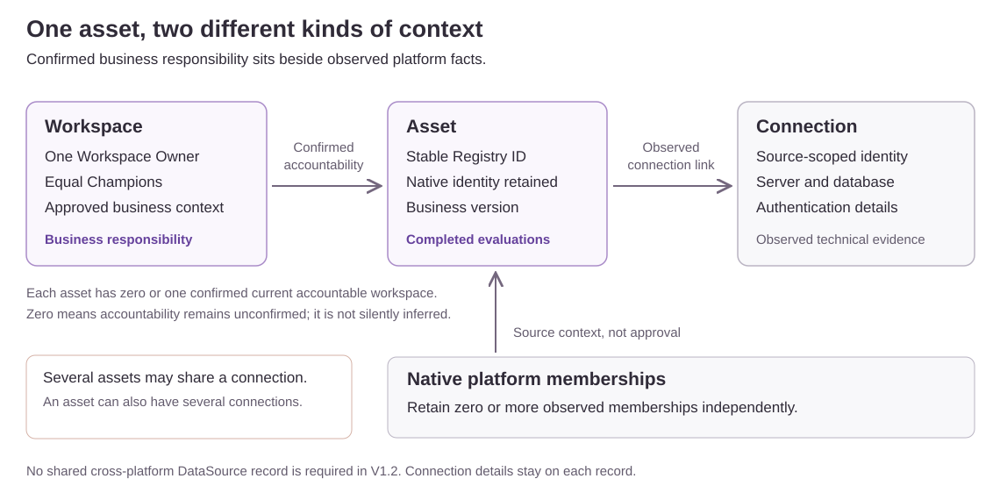
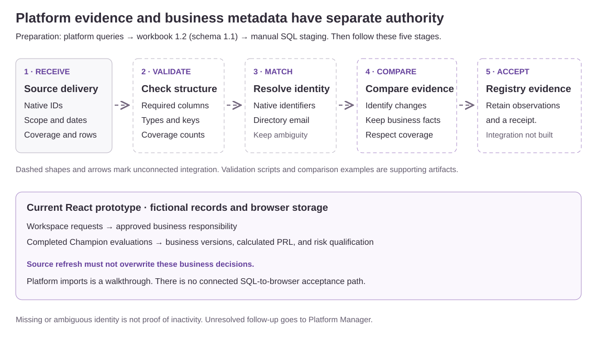

# Analytic Registry V1.2 local baseline

**Baseline ID: `1.2.0-prototype.1-local` · 20 October 2026**

This baseline records a coherent local prototype for review. It is not a production release or a new published GitHub tag.
The [current guide](v1.2-guide.md), [requirements](v1.2-requirements.md), and [verification](v1.2-verification.md) define its meaning and limits.

## What this baseline fixes

| Area | Baseline decision |
|---|---|
| Application | V1.2 local React prototype with five primary sections |
| Data delivery | Workbook revision 1.2; input schema 1.1 retains all 11 tables, 72 columns, types, keys, and query interfaces |
| Current instructions | V1.2 guide and requirements take precedence over earlier workflow descriptions |
| Business authority | One Workspace Owner and equal Champions; existing eligible approval rules remain intact |
| Asset governance | Completed four-step evaluations; calculated PRL; no asset approval queue or asset Annual Attestation |
| Evidence | Native identity, source observations, business declarations, and historical decisions retain separate meanings |
| Publishing | Local only; last published baseline remains `v1.1.0-prototype.2` |

## Read the visuals

Each arrow names the relationship or handoff it represents. It does not imply that an integration is deployed.
Purple identifies business responsibility. Neutral panels describe source evidence. Dashed paths describe unconnected integration work.

An asset has at most one confirmed current accountable workspace. An unresolved association remains visible.
Observed platform memberships remain separate evidence. Multiple assets can share a connection.
Server and database details stay on each connection; a common cross-platform DataSource record is deferred.

The source queries and Excel format support a manual handoff. Installed-source execution remains unverified.
The React import page demonstrates comparison steps. It does not accept SQL staging records into the registry.
Approved business workflows supply business metadata. Source refresh must not overwrite that metadata.

## Manifest and snapshot

The local snapshot lives under `baselines/1.2.0-prototype.1-local` in the application folder.
Its `manifest.json` records every included file, byte size, SHA-256 checksum, and artifact category.
A SHA-256 checksum identifies the exact file bytes; it is not proof of platform compatibility.

The snapshot contains current application source, current and historical documentation, public resources, platform collection files, and verification evidence.
Historical material stays labeled. The application source folder is authoritative; any earlier served source copies remain historical references.
Dependencies, browser storage, secrets, scratch work, and Git metadata are excluded.

The manifest records application `1.2.0-prototype.1-local`, workbook revision `1.2`, and input schema `1.1` separately.
It names the current guide, workbook, query handoff, diagrams, and verification evidence as entry points.
The manifest excludes itself from its file list to avoid a self-referencing checksum.

Run `npm run baseline:local` to create this version's snapshot after validation.
An existing baseline is verified against its recorded checksums and is never silently overwritten.
Later source changes need a new baseline identifier before creating another snapshot.

## Workbook changes

The current workbook reduces repeated definitions from 216 rows to 72. Three platform output tabs retain explicit collection and NULL rules.
The historical migration sheet moves outside the workbook. Its existing JSON map and the earlier workbook remain available for comparison.
The Guide uses the app's five stages: Receive, Validate, Match, Compare, Accept.
Workspace subtype remains a source attribute; it does not participate in workspace identity. Asset identity still includes native asset type.
Optional connection identity classification remains available. Current query profiles establish only Unknown; it cannot prove a control result.

No input-column migration is needed. Operators must still verify source mappings against installed platform schemas before their first live delivery.

## Acceptance and limits

The recorded checks establish bounded local behavior. See [verification](v1.2-verification.md) for results and screenshots.
No live SQL import, production identity service, recurring detection, or import-tested Power App is included.
Annual policy, retirement operations, freshness thresholds, and additional shared-case decisions remain open.
This baseline does not resolve them by implication.
