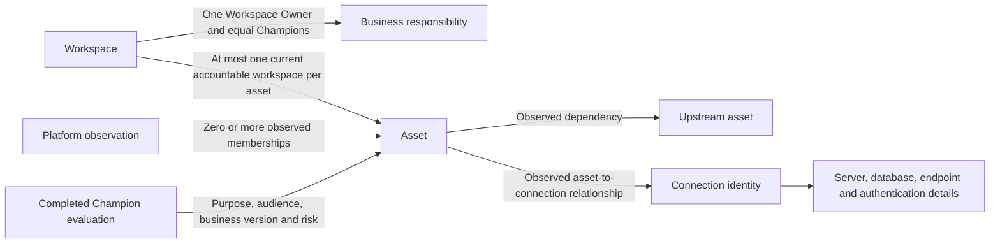
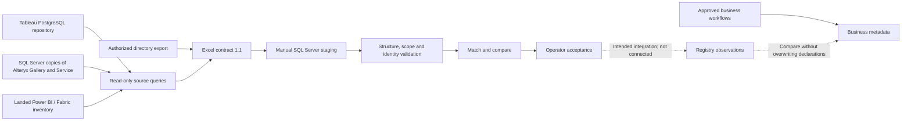

# Analytic Registry V1.2 — product and workflow guide

**1.2.0-prototype.1 · Prototype release · 21 October 2026**

This is the current guide for the local React application. It replaces earlier product instructions where they differ. Published V1 and V1.1 baselines remain historical.

The application uses fictional records and browser storage. Business workflows operate locally. Platform collection, manual SQL staging, and future registry loading remain separate activities.

## Find the right document

| Need | Start here |
|---|---|
| Understand pages, people, and actions | This guide |
| Check implemented behavior and remaining work | [V1.2 requirements](v1.2-requirements.md) |
| Review checks actually run | [V1.2 verification](v1.2-publication-verification.md) |
| Understand detection evidence and risk buckets | [Detection Coverage and Risk Buckets](v1.2-risk-and-coverage.md) |
| Use a consistent term | [Glossary](../GLOSSARY.md) |
| Supply platform data | [Extract handoff](../../platform-data-collection/v1.2-workbook/README.md) |
| Populate the agreed format | [Excel workbook revision 1.2](../../platform-data-collection/v1.2-workbook/analytic-registry-v1.2-extract.xlsx) |
| Understand a common field | [Extract column dictionary](../../platform-data-collection/v1.2-workbook/column-dictionary.csv) |
| Map a source or preserve NULL | The workbook's Tableau_Output, PowerBI_Output, and Alteryx_Output tabs |
| Understand monthly matching and evidence | [Monthly reconciliation](../../platform-data-collection/v1.1-extract/monthly-reconciliation.md) |

**The application and workbook revision are V1.2; the input schema remains 1.1.** Table names, headers, types, and keys remain compatible.
The workbook has 16 sheets: 11 input tables, one guide, one common dictionary, and three platform mappings.
Each of the 72 column positions has one common definition. Each platform tab provides its applicability, source, value, and NULL rules.
Platform tabs are reference material, not additional import tables. The historical migration map remains beside the query files.

## Product purpose

Analytic Registry connects analytics content, business responsibility, and source evidence. It helps people identify what exists, who is accountable, and which action needs attention.

A source observation describes what a platform reported. A business declaration describes intended purpose, responsibility, or data use. Each has its own authority and dates.

Registration establishes approved business accountability. It does not establish technical compliance. An implementation receipt records reported external work; it does not prove that later source evidence agrees.

## Pages and essential actions

Five primary sections remain. Administration stays in a separate menu. The application starts in Business view and uses a 1366 × 768 design canvas.

| Section or page | Purpose | Main actions |
|---|---|---|
| Dashboard | Show personal attention items and summary counts | Open the next task; find a workspace; start a request |
| Workspaces | Find governed areas and their business responsibility | Filter the list; open a workspace; register a discovered workspace |
| Workspace detail | Keep business context beside platform evidence | Inspect Overview, Assets & connections, Access & configuration, Work, and History; request a change |
| Assets | Find analytics content and its accountable workspace | Filter records; inspect Governance & risk; open the next action |
| Asset detail | Separate observed technical details from declared business context | Inspect Overview, Connections, Governance & risk, and Work; record an evaluation; confirm accountability |
| Requests | Track proposed business changes and separate technical work | Create, register, update, save a draft, submit, record eligible approval, or record external work |
| My work | Bring assigned work and findings into one place | Filter work; open a Review case or Annual Attestation; inspect mapped Workspace and Asset |
| Annual Attestation | Confirm a workspace's frozen annual packet | Inspect the packet; answer applicable questions; submit for owner approval |
| Review case | Investigate an issue and record the response or evidence | Read context; record permitted decisions; request approval for evidence closure |

Workspace lists show the active profile's assignments. Retired workspaces are hidden by default; **Include retired** changes visibility only. It does not retire or restore a workspace.

The My work URL retains its filters through reload and navigation. Unknown referenced people remain visible by ID. A missing reference differs from an unassigned task.

| Administration page | Purpose and limits |
|---|---|
| Platform imports | Explain Receive, Validate, Match, Compare, and Accept; show query references and synthetic comparisons. It does not load SQL records. |
| Detection coverage | Show which conclusions the available evidence can support. Sample risk fixtures do not prove live detection. |
| Configuration standards | Explain Standard groups, Custom requirements, and comparison terms. Proposed settings are not approved policy. |
| Data foundation | Show the extract contract, field applicability, proposed entity grains, and refresh examples. The design catalog is not a deployed database. |
| Reference data | Inspect mock people and terms; export browser records; explicitly reset the demo with recovery safeguards. |
| Activity / history | Inspect recorded requests, implementation, observations, reviews, and attestation events. |

Business and Administrator views simulate profiles. An Administrator profile can select eligible actors in designated controls. This is a testing facility, not production authorization.

## Responsibility and authority

| Role or source | Authority |
|---|---|
| Workspace Owner | One accountable person for the workspace |
| Champion | Equal workspace authority with every other Champion; business expertise, eligible request approval, completed asset evaluations, and issued annual responses |
| Application Owner or Platform Owner | Required Custom configuration and Annual Attestation approval |
| Platform Administrator | Applicable technical approval and recording of external implementation or verification |
| Platform Manager | Unresolved identity or relationship follow-up; documented asset-accountability transfers or corrections |
| Platform Manager, Platform Team, or Platform Owner | Eligible approval of the exact evidence used to close a Review case |
| Registry operator | Intended manual acceptance of structurally valid source deliveries; no substitute business approval authority |
| Platform or directory evidence | Technical observations or identity evidence within the stated source, scope, and observation time |

Workspace Owner and business-process expertise are separate concepts. When a technology team builds for others, the business-process subject-matter expert participates as a Champion.

All Champions have the same authority. Champion responsibility does not grant publish, modify, or connection permissions. Group permissions remain separate platform evidence.

An assignment becomes effective after required approval and its recorded effective date. New actions recheck current eligibility. Historical receipts retain their original approval evidence.

## Workspace requests

Choose **Create New**, **Register Existing**, or **Update Existing**. Register Existing selects a discovered workspace; it does not create another platform object.

| Request path | Guided form steps |
|---|---|
| Existing workspace, business changes only | 1. Workspace & people → 2. Data & risk → 3. Review & submit |
| Create New, or an existing workspace with technical changes | 1. Workspace & people → 2. Data & risk → 3. Setup → 4. Groups & access → 5. Review & submit |

Workspace & people records the platform, business name, purpose, Workspace Owner, Champions, business line, and effective date. Directory business line provides context only.

Data & risk records classification, criticality, PII, EUCT, and the highest applicable Data Management Policy tier. Tier 1 is highest, followed by Tier 2 and Tier 3.

Setup records Standard or Custom configuration. Groups & access records workspace-associated groups. Standard retains Champion, RW, R, and Data Sources purposes.

The Data Sources group uses the `_DS` suffix. Its purpose is connection creation and maintenance, subject to supported platform roles. Groups have no separate business-owner field.

One eligible current Champion approves business declarations and Workspace Owner or Champion changes. Initial setup can use an active, verified proposed Champion when no effective roster exists.

A replacement Champion cannot approve their own appointment in an already governed workspace. Self-approval remains allowed when the person already holds the required eligible role.

Custom configuration still requires Application Owner or Platform Owner approval. Applicable technical work still requires Platform Administrator approval. Missing eligible Champions route to Platform Manager without granting replacement approval authority.

Business-only requests do not create configuration versions or groups. Register Existing and applicable Update Existing requests can complete business changes while linked technical work remains open.

Submitted intent is preserved. Corrections use a linked draft with fresh approval context. Legacy requests retain their original policy and receipts.

## Assets, connections, and business versions

An asset can appear in several observed platform memberships. These memberships do not select its accountable workspace. Several assets can use one observed connection.

Keep database and server details on each connection for this version. A shared cross-platform DataSource record and automatic endpoint matching remain deferred.

An eligible Champion confirms an initial accountable workspace on the same platform. Platform Manager records later transfers or corrections with a reason and traceable business confirmation.

An accountability change preserves native memberships, evaluations, and existing cases. Unresolved confirmation leaves the current association unchanged.

| Change | Business version rule |
|---|---|
| Material purpose, logic, result meaning, data use, or intended audience change | Create a new business version with a completed evaluation |
| Equivalent material technical change | Record another evaluation of the same business version |
| Corrected declaration | Record another evaluation; preserve the earlier entry |
| Routine refresh, rename, native revision, or presentation-only change | No automatic new business version |
| Historical evidence | Keep it in history without replacing current business context |

A native revision is source evidence. A business version is an explicit declared release. A successful new-version evaluation saves the version and current business context together.

### Complete Governance & risk

Only an active, verified, current Champion of the accountable workspace can record this evaluation. The acting user becomes its recorder.

1. Complete **Business context**, including version, purpose, audience, and evaluation date.
2. Complete **PRL inputs**, keeping unknown counts explicit.
3. Complete **Governance**, including PII, EUCT, and DMP tier.
4. Add **Evidence & save**, then save the completed evaluation.

This process has no saved draft, separate asset approval queue, or asset Annual Attestation. An optional external work reference does not create a case.

PRL-01 calculates a level from three inputs. It does not calculate a numeric score.

| Input | PRL 3 | PRL 2 | PRL 1 |
|---|---|---|---|
| Calculation or transformation complexity | Simple | Moderate | Complex |
| Distinct logical sources | 0–3 | 4–10 | 11 or more |
| Intended human audience | 0–50 | 51–500 | 501 or more |

The most demanding applicable answer determines PRL. A known PRL 1 condition is conclusive. Otherwise, an unknown applicable answer leaves PRL **Not determined**.

Automated use can exclude human audience size when a reason is recorded. Logical source count describes dependencies, not the number of connection rows.

Row-level security, processing mode, dataset size, and duration provide supporting context. They do not change PRL-01.

**High risk = PRL 1 OR PII Yes OR EUCT Yes OR DMP Tier 1, Tier 2, or Tier 3.**

Untiered is an explicit DMP answer, distinct from Unknown. Ruling out High risk requires enough information to exclude every qualifying condition.

High risk is an asset qualification, not a failed control or a Finding severity. Saving a High risk evaluation does not automatically create a Review case.

## Annual Attestation and Review cases

These remain different workflows. Neither replaces the completed asset evaluation.

| Workflow | Guided steps | Current behavior |
|---|---|---|
| Annual Attestation | Review workspace → Confirm details → Response & approval | Issued Champions review a frozen packet. Application Owner or Platform Owner approval completes the response. |
| Review case | Understand the issue → Decision & ownership → Evidence & approval | Business users respond to eligible assigned work. Administrators record investigation and evidence. Exact closure evidence needs eligible platform approval. |

Annual recipients remain those captured at issue. A later Champion roster does not silently replace them. Linked corrections can remain open after an approved annual response.

Pending-approval and completed annual responses are read-only for response editing. Completed Review cases are read-only. Earlier packet context and decisions remain available.

The local browser verification inspects annual packets and Review cases without changing those records. It does not certify a new annual policy or production evidence-closure process.

Annual scheduling and response policy, retirement operations, freshness thresholds, and additional shared-case behavior still need decisions. Existing prototype behavior is not approval of those policies.

## Platform evidence to registry

The diagram describes the intended operating path. The local app contains examples and business commands; it does not connect staging to browser records.

| Platform | Query input | Important limit |
|---|---|---|
| Tableau | PostgreSQL repository, scoped to the site | Verify the installed repository and read permissions before running the supplied queries |
| Alteryx | SQL Server copies of Gallery and Service, with mapping views | Confirm exported columns and array representation for the target 2025.2 installation; no API collector is introduced |
| Power BI / Fabric | Already-landed inventory queried with Fabric SQL | Inventory does not establish full access, ownership, or connection evidence; no internal repository tables are assumed |
| Directory | Authorized directory export | Keep tenant, object ID, Mail, enabled state, and evidence time separate |

Use the [source-query design](../../platform-data-collection/v1.1-extract/source-query-design.md) for SQL files, mapping points, and vendor references. Installed database execution remains unverified.

The manual delivery uses five stages:

1. **Receive** the immutable files, RunKey, source scope, evidence time, and mapping revision.
2. **Validate** required keys, headers, types, duplicate identities, coverage, and row counts.
3. **Match** stable native identities and candidate directory identities.
4. **Compare** new, changed, unchanged, missing, and unverifiable observations.
5. **Accept** valid evidence through the registry operator and assign unresolved follow-up to Platform Manager.

A structural error blocks the whole delivery. Structurally valid Partial evidence and unresolved references remain usable. Keep invalid rows for correction; do not silently drop them.

Complete coverage needs verified scope and an exact delivered count. Partial absence does not establish deletion. Failed or NotCollected data preserves earlier evidence and its original date.

### Stable identity and email matching

| Identity | Meaning | Exclude from the identity |
|---|---|---|
| Registry ID | Permanent registry record identifier | Display name, refresh month, current membership |
| Native object identity | Platform, instance, scope, object kind, and native ID; assets also use native type | Business name, owner email, RunKey |
| Source identity | Source principal within its native namespace | Display-name changes |
| Person | Directory tenant and directory object ID | Email as a permanent key |
| RunKey | One immutable source delivery | Enduring asset or workspace identity |

Compare trimmed, case-insensitive SourceEmail with directory Mail in the configured tenant. Require exactly one accepted matching evidence record. UPN is not a fallback.

A disabled match remains resolved-disabled. Missing, ambiguous, conflicting, or failed resolution does not prove inactivity. Platform Manager receives unresolved cases and disabled-account accountability review.

Renames and membership moves retain Registry IDs. Native-ID changes require a new identity or a reviewed continuity mapping. Source refresh never overwrites approved business responsibility or governance declarations.

An identical delivery retry must reuse its acceptance result. Changed content under the same RunKey must be rejected. These are production acceptance requirements, not a deployed loader claim.

## Local use and limits

Use **Export browser data** before a demo reset. Loading failures preserve original data. Stale writes from another browser tab are rejected.

The six-month history objective is agreed. Retention scheduling is not implemented. Current identity, open work, and evidence supporting active decisions must remain available.

Production authentication, recurring ingestion, transactional acceptance, live detection, and SQL deployment remain integration work. The offline Canvas app is unfinished; no import-tested `.msapp` is claimed.

Use the [V1.2 requirements](v1.2-requirements.md) for these boundaries and the [verification record](v1.2-publication-verification.md) for evidence. Earlier review documents explain history; they do not override this guide.
