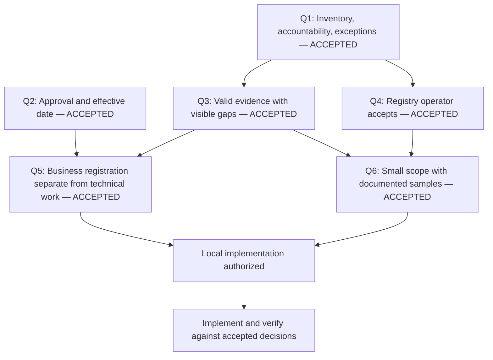

# V1.1 design interview

Started 9 October 2026. Status: **Q1–Q6 accepted; local workflow, evidence, and sample changes verified**. Live integration remains unverified.

This record accompanies the user-invoked grill-with-docs interview. The user accepted A for all six questions on 9 October 2026. These notes do not change the published `v1.1.0-prototype.2` baseline.

The interview follows two rules: ask decisions only when their prerequisites are settled, and record accepted meaning as it becomes clear. The user subsequently authorized all accepted changes locally, with local validation before any further GitHub push. Glossary updates distinguish accepted meaning from unresolved proposals. Accepted decisions do not imply completed runtime changes.

## Confirmed constraints

- Refresh platform observations at least monthly, using the Excel handoff and manual SQL Server loading.
- Query Alteryx Gallery and Service exports in SQL Server. Use PostgreSQL for Tableau and the documented query route for Fabric.
- Preserve native identifiers independently of registry identifiers, names, emails, and delivery keys.
- Match explicit platform email to directory mail within the configured tenant. Unresolved cases go to Platform Manager.
- Preserve approved business metadata when source observations change.
- Keep the confirmed approval roles, self-approval eligibility, DMP ordering, manual PRL, DS group purpose, and six-month history decision.
- For the first live pilot, prove observed inventory, approved business accountability, and assigned exceptions.
- Make both owner and Champion changes effective after required approval on the recorded effective date. Do not require separate incoming-person acceptance.
- Use the available V1 evidence. Prioritize trust and ease of use.
- Accept structurally valid partial source deliveries and retain unresolved references as assigned work. Structural errors block the whole delivery.
- Let the registry operator, initially the user, record source-delivery acceptance after validation. No additional approval is needed for routine imports.
- Complete Register Existing business registration after required information, approvals, and the effective date. Track required technical changes as linked open work.
- Start with a small, named scope from each platform. Use vendor documentation and examples to prepare clearly labeled sample deliveries.
- Retain fewer than six main sections and fewer than six steps in guided processes.
- Use a fixed 1366 × 768 design canvas for V1.1 tablet/landscape testing before a future Power Apps conversion. The user explicitly authorized this sizing change.

See the [decision register](decision-register.md), [current baseline](v1.1-prototype-baseline.md), and [monthly reconciliation](resources/platform-data-collection/v1.1-extract/monthly-reconciliation.md). Earlier daily-frequency proposals are not accepted replacements for the monthly requirement.

## Decision tree

No product questions remain in this interview. The user authorized local implementation and validation. GitHub publication remains paused for local review.

## Round 1: accepted decisions

| ID | Decision | User answer | Result |
|---|---|---|---|
| Q1 | What must the first live pilot prove? | A | Observed inventory, approved business accountability, and assigned exceptions. Broader requirements remain; unsupported controls are outside the initial acceptance target. |
| Q2 | When do approved owner and Champion changes become effective? | A for both roles; keep it simple. | Required approval plus recorded effective date. No additional incoming-person acceptance. Technical implementation remains separate. |

### Evidence for Q1

**Observed:** the current Fabric query supplies three Partial datasets: workspaces, assets, and their memberships. Six datasets remain NotCollected. The query alone cannot establish complete ownership, access, connection, or directory evidence. See the [Fabric mapping](resources/platform-data-collection/v1.1-extract/fabric-query-mapping.md).

**Observed:** the React application uses mock findings. The monthly comparison helper does not persist an accepted delivery or update operational findings. See the [operating review](v1.1-product-operating-review.md).

**Inference:** a broad governance pilot would require more verified inputs and operational processing than the current extract and prototype provide.

**Accepted Q1:** judge the first live pilot by a working inventory-to-accountability-to-exception process. Existing risk and workflow requirements remain for later operational coverage.

### Evidence for Q2

**Observed before implementation:** `currentChampionIds()` derived current Champions from the implemented configuration version. Issued annual packets retain their frozen recipient lists. This code fact concerns Champion routing; it does not prove that every owner transition uses the same mechanism. See [responsibility helpers](source/src/utils/authority.ts).

**Observed:** the operating review identifies the implementation version as a proxy for accepted responsibility. It leaves an explicit business-acceptance policy unfinished.

**Scenario:** an owner or Champion change is approved today, while platform access changes finish next week. Under accepted Q2, newly created work follows the approved assignment once its effective date has arrived, even if technical implementation remains pending.

**Accepted Q2:** use required approval and the recorded effective date for both owners and Champions. The user rejected the recommended extra acceptance step for incoming owners to keep the workflow simple. See [ADR 0001](adr/0001-effective-business-responsibility.md). The local helper now uses approved business responsibility separately from technical implementation. See the local verification section below.

## Terminology recorded during the interview

The [glossary](GLOSSARY.md) now separates **Source delivery** from **Implementation receipt**. The existing request interface says "Delivery recorded" for platform work, while extraction documents use delivery for source observations. These concepts already have different evidence and authority; the terminology clarification introduces no new approval rule.

Other clarifications preserve existing behavior: duplicate directory evidence remains ambiguous, Person identity is independent of email, groups and applications do not become people, and Partial or NotCollected coverage does not establish absence. Historical workbook sizes and table counts belong in baseline documents rather than domain definitions.

Effective responsibility is now defined from accepted Q2. It does not grant platform access, revise historical approvals, or replace frozen annual recipients.

Business registration is now defined from accepted Q5. Its completion establishes recorded business accountability, not technical compliance or completed remediation.

## Decision record policy

ADR 0001 records Q2 because responsibility controls future assignments and historical interpretation, differs from the current implementation proxy, and reflects an explicit simplicity trade-off. Q1 is recorded here as a pilot scope decision; it does not need a separate ADR. ADR 0002 records the acceptance boundary because it determines which evidence enters the registry and deliberately permits unresolved references. ADR 0003 records the registration boundary because it separates durable business status from technical work, contrary to the current shared request stages. Q6 is a validation-scope decision and needs no separate ADR. Routine vocabulary changes stay in the glossary.

## Round 2: accepted decisions

| ID | Decision | User answer | Result |
|---|---|---|---|
| Q3 | What may update the registry when a source delivery has gaps or defects? | A; use what is available for V1, focusing on trust and ease of use. | Accept structurally valid partial deliveries and unresolved references. Structural errors block the whole delivery for correction. No silent row skipping or selective acceptance of defective deliveries. |
| Q4 | Who records acceptance of a validated source delivery? | A | The registry operator, initially the user, records acceptance after validation. Platform Manager owns unresolved cases. Routine imports need no additional approval. |

### Evidence for Q3

**Observed before implementation:** the [SQL validator](resources/platform-data-collection/v1.1-extract/sqlserver-validation.sql) treated every returned issue as blocking, including unresolved references. The [reconciliation process](resources/platform-data-collection/v1.1-extract/monthly-reconciliation.md) allowed acceptance with unresolved cases assigned to Platform Manager. The local updates now distinguish these outcomes.

**Required distinction:** malformed or duplicate native keys differ from valid source records whose account reference cannot be resolved. Partial coverage also differs from malformed data. The current Fabric route intentionally emits Partial inventory coverage.

**Accepted Q3:** structural failures stop the initial manual delivery. Valid partial observations and unresolved references may be accepted with their original coverage and assigned follow-up. Selective dataset acceptance was not selected. See [ADR 0002](adr/0002-accept-valid-evidence-with-visible-gaps.md). The local SQL diagnostics and workbook now use this boundary.

### Evidence for Q4

**Confirmed:** the user will load extracts manually into SQL Server. Platform Manager receives unresolved cases.

**Resolved by Q4:** the registry operator records that validated source evidence may become current registry evidence. Source-delivery acceptance remains distinct from business declarations, Custom approvals, annual approval, and evidence closure.

**Accepted Q4:** the registry operator, initially the user, records source-delivery acceptance after the agreed checks. No further routine import approval is required. Existing business approval roles remain unchanged.

## Consequences of trust and ease of use

These follow the accepted decisions and existing requirements. They are implementation guidance, not additional product approval gates.

- Show observation dates and coverage beside source-derived information.
- Keep Partial and NotCollected visible. Neither proves a failed control.
- Retain prior accepted evidence with its original age when a new delivery fails or does not collect that dataset.
- Keep source technical ownership separate from approved business ownership.
- Route unresolved accountability to Platform Manager.
- Repeated observations of one unresolved issue remain one case with linked occurrences.
- Keep unsupported risk results unavailable or clearly illustrative during the inventory pilot.
- Present missing information as a specific next action instead of forcing unsupported values into required fields.

The updated [evidence helper](source/src/utils/evidence.ts) separates `inventoryAvailable` from `controlReady`. Partial inventory remains visible without presenting incomplete comparisons as verified. The mock workspace adapter still uses one completeness flag; dataset-specific persisted evidence remains future integration work.

## Round 3: accepted decisions

| ID | Decision | User answer | Result |
|---|---|---|---|
| Q5 | May Register Existing finish business registration while required technical changes remain open? | A | Complete business registration after required information, approvals, and the effective date. Track required technical changes as linked open work. Preserve applicable Custom and sensitive-data approvals. |
| Q6 | How large should the first pilot population be? | A; use samples and examples from vendor user guides and application documentation. | Start with a small, named scope from each platform. Prepare documented samples for initial load, unchanged replay, and changed refresh. Validate installed sources separately before live reliance. |

### Evidence for Q5

**Observed before implementation:** [request approval logic](source/src/utils/approvals.ts) always adds Technical setup approval. [Request stages](source/src/utils/workflow.ts) require external implementation and verification for every request type, including Register Existing.

**Inference:** completing business accountability for an existing workspace can be delayed by technical work. Q5 settles the registration boundary independently of that work.

**Accepted Q5:** capture approved purpose, owner, Champions, and declarations against the accepted native workspace identity. Complete business registration when required information and approvals are complete and the effective date has arrived. Required technical changes remain linked and open until independently completed and verified. Existing approval requirements still apply to the relevant business, sensitive-data, or Custom decision. Registration does not prove technical compliance or completed remediation. See [ADR 0003](adr/0003-separate-business-registration-from-technical-work.md).

### Evidence for Q6

**Accepted Q6:** use a small, named scope from Alteryx, Tableau, and Fabric. Use vendor user guides and application documentation to define fields and representative examples. These commercial off-the-shelf products have documented schemas and interfaces; source research is engineering work, not another product-owner question.

**Evidence boundary:** distinguish vendor-provided examples from synthetic records created from documented fields. Label synthetic identifiers, names, emails, and observations explicitly. Samples do not establish estate completeness or prove execution against the installed platforms. Documentation also does not determine the physical layout of the user's SQL Server exports or landed Fabric data.

**Planned verification:** use an initial accepted delivery, an identical replay, and a later changed refresh. Confirm stable registry IDs, preserved business metadata, approved responsibility changes, and recurring exceptions without duplicate cases. Check partial coverage, unresolved references, and structural rejection under Q3. Check registration completion separately from open technical work under Q5. These are planned checks, not live execution results.

## Implementation boundary

All six interview choices are settled. The user authorized all changes locally and requested local validation before another GitHub push. Installed-schema checks and live execution remain delivery verification, not unanswered product choices.

## Local Q2 and Q5 verification

The local prototype now applies approved owner and Champion assignments after their effective date. A business-application receipt records the native workspace identity and approval references. New requested configuration versions preserve the approved business context. Implemented configuration and platform observations remain unchanged.

Register Existing records business completion separately from linked technical work. Without a saved business receipt, its status remains Ready for registration. Custom and sensitive-data approvals remain required. New assignments require active, verified people; unresolved cases remain assigned to Platform Manager. Existing frozen annual recipients and historical approvals remain intact.

The store checks due assignments on load, after saved changes, and once per minute while open. This is local browser behavior. No background service, production authorization, live import, or platform provisioning is claimed.

[Responsibility regression checks](source/scripts/v11-responsibility.check.ts) passed 79 assertions. Cases include stale forms after approval, unresolved-owner routing, and approval dates across UTC midnight. Calendar dates use America/New_York consistently. These checks use synthetic prototype records; installed-platform validation remains separate.

## Local Q1, Q3, Q4, and Q6 verification

The dashboard and Data foundation page identify inventory, accountability, and assigned exceptions as the first pilot scope. Unsupported risk findings remain illustrative or unavailable.

The SQL validator now distinguishes structural errors from unresolved references. Forty-one scenarios exercise 101 diagnostic predicates through SQLite translation. This does not verify SQL Server execution. The workbook assigns routine acceptance to the registry operator and unresolved cases to Platform Manager.

The browser evidence helper passed 47 checks for inventory, control readiness, coverage, and retained dates. [Platform samples](resources/platform-data-collection/v1.1-extract/samples/README.md) passed 291 checks using the actual comparison and identity helpers. Each platform has initial, replay, and changed-refresh deliveries. All records are explicitly synthetic and shaped from official documentation.

Persistent replay protection, transactional merging, and recurring-case upserts remain unimplemented. The sample checks do not claim those outcomes. See [the current verification record](v1.1-verification.md).
