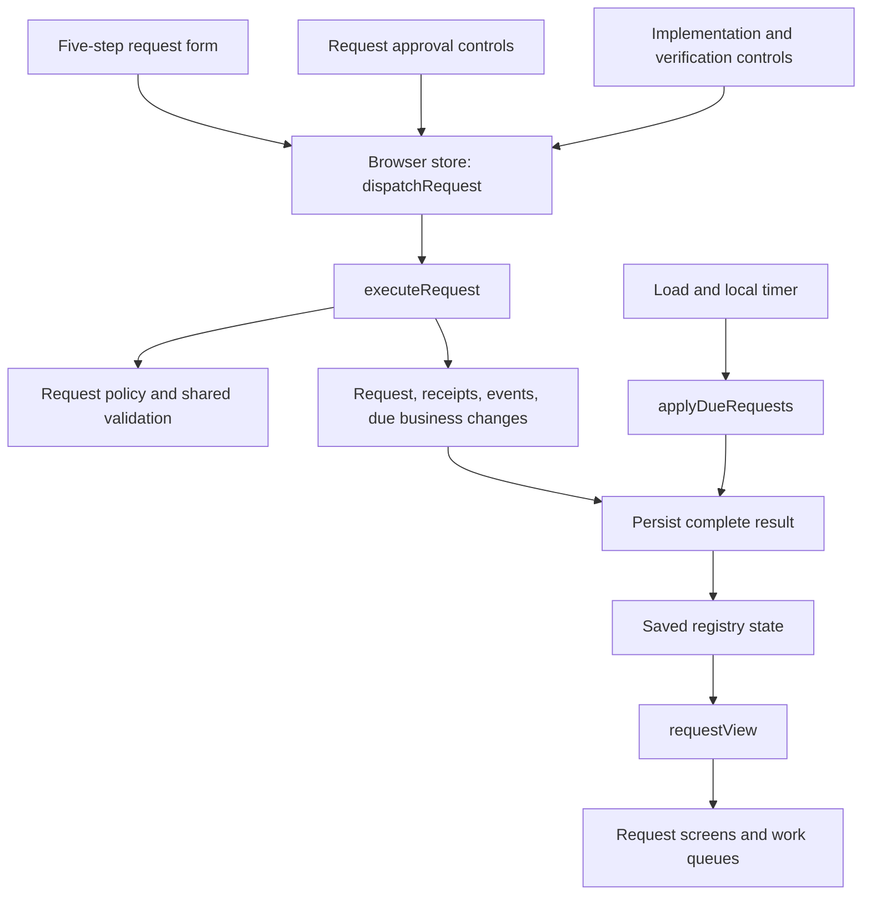

> **Earlier architecture reference.** Use the [V1.2 guide](v1.2-guide.md) for current request behavior, including three-step business-only forms and five-step technical forms. This earlier module description remains unchanged.

# Workspace request module

Implemented locally in `1.1.0-prototype.3-local`, 9 October 2026. The published GitHub baseline remains unchanged.

Workspace requests now use one module for actions, status, and effective business changes. The existing five-step form and approved product rules remain.

## Why this changed

Request actions previously crossed form handlers, shared approval controls, execution controls, queue helpers, and the browser store. Tests often called individual rules directly.

The new module increases depth: callers name an action, while the module handles validation, receipts, events, and due business changes. This improves locality when changing request behavior. Screens and scenario tests now share the same interface.

## Interface and ownership

The [public module](https://github.com/dlpate2525/analytic-registry/blob/v1.2.0-prototype.1/analytic-registry/src/domain/requests.ts) has three entry points:

| Entry point | Responsibility |
|---|---|
| `requestView(data, requestId, asOf)` | Read the saved request and derive its business stage, technical stage, approvals, correction availability, and queue action. |
| `executeRequest(data, command, context)` | Validate and return one complete action. Commands are save, submit, correct, approve, implement, and verify. |
| `applyDueRequests(data, asOf)` | Apply approved business responsibility when its date arrives. Repeated calls without new work return the original data. |

The command context supplies the actor, timestamp, and ID generator. Tests can therefore use fixed dates and identities without replacing application rules.

The [internal policy](https://github.com/dlpate2525/analytic-registry/blob/v1.2.0-prototype.1/analytic-registry/src/domain/requestPolicy.ts) owns request stages, actor checks, corrections, technical evidence, and business application. Existing shared approval and field rules remain reusable. Compatibility exports preserve focused regression checks and historical callers.

The [browser store](https://github.com/dlpate2525/analytic-registry/blob/v1.2.0-prototype.1/analytic-registry/src/data/store.tsx) is the persistence adapter. It calls the command with current saved state and writes the complete result once. A failed write leaves the in-memory record unchanged. Existing detection of competing browser-tab writes remains in place.

This command boundary is the seam for a future server implementation. It does not provide production authentication or a database transaction today.

## Requirements preserved

- Business Owner and Workspace Owner remain one field. Champions stay with workspace accountability.
- Standard requests retain Champion, RW, R, and Data Sources groups, including `_DS`.
- PII, EUCT, highest DMP tier, and Custom approvals retain their current rules.
- Eligible self-approval remains allowed. New decisions check current role eligibility.
- Submitted intent and historical approvals remain unchanged. Corrections create linked requests with fresh approvals.
- Approved business responsibility starts after approval and the effective date. Technical implementation remains separate.
- Register Existing can complete business registration while required technical work remains open.
- Technical receipts do not manufacture platform observations or overwrite implemented configuration.
- Create New remains open until its delivered workspace has a registry link.
- Historical annual recipients remain unchanged. Unresolved ownership routes to Platform Manager.

## Consistency repairs

Commands resolve the saved request before deciding what is allowed. A stale draft cannot replace submitted intent. An approval with an outdated intent key is rejected.

Business stages now use a typed result instead of comparing an explanatory sentence. Changing help text cannot change the stage calculation.

Due processing checks both approval and effective dates. A historical `asOf` date cannot apply responsibility before its approval date.

The Requests open filter now agrees with My work about completed Create New requests awaiting a registry link.

## Local validation

The [command scenario checks](https://github.com/dlpate2525/analytic-registry/blob/v1.2.0-prototype.1/analytic-registry/scripts/request-module.check.ts) exercise the public interface. They cover stale intent, current eligibility, Custom approval, correction, effective dates, technical evidence, and historical preservation.

All 132 new assertions passed. The complete application suite passed 867 assertions. TypeScript passed. Browser checks passed nine registration scenarios and 136 route, layout, and form checks.

See the [verification record](v1.1-verification.md) for build and artifact results. These checks use synthetic local data. No live platform execution or Power Apps import is claimed.

## Deliberate limits

The module is in-process TypeScript. It adds no framework, endpoint, table, workflow step, or deployment dependency. The registry still uses one browser snapshot.

The main leverage is one behavior path for UI actions and tests. Future SQL or Power Apps work must enforce equivalent rules with authenticated server operations. That work remains separate.
