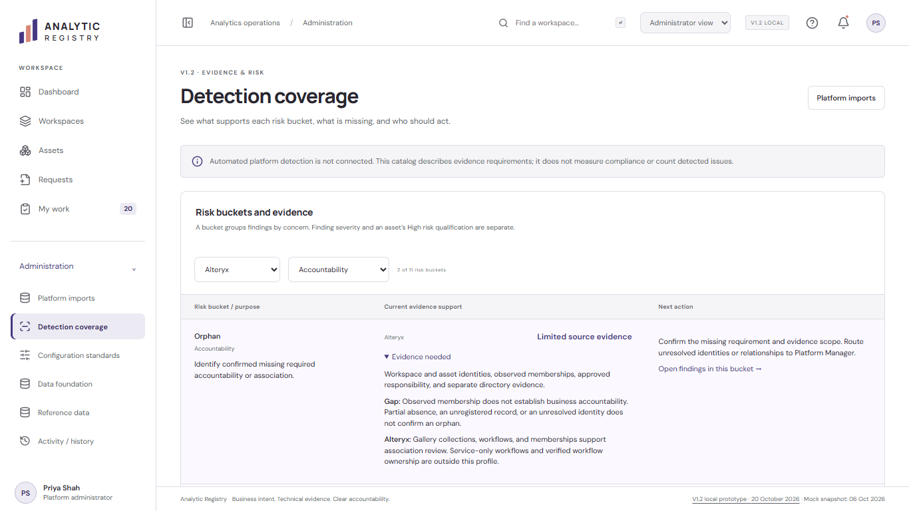
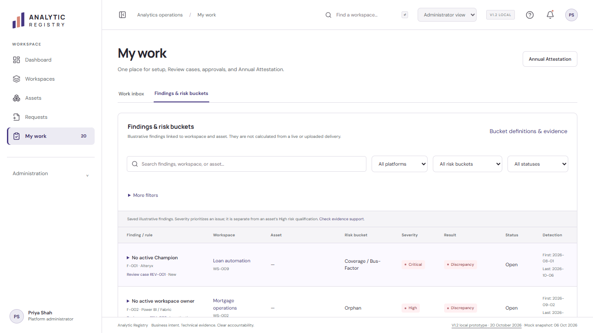
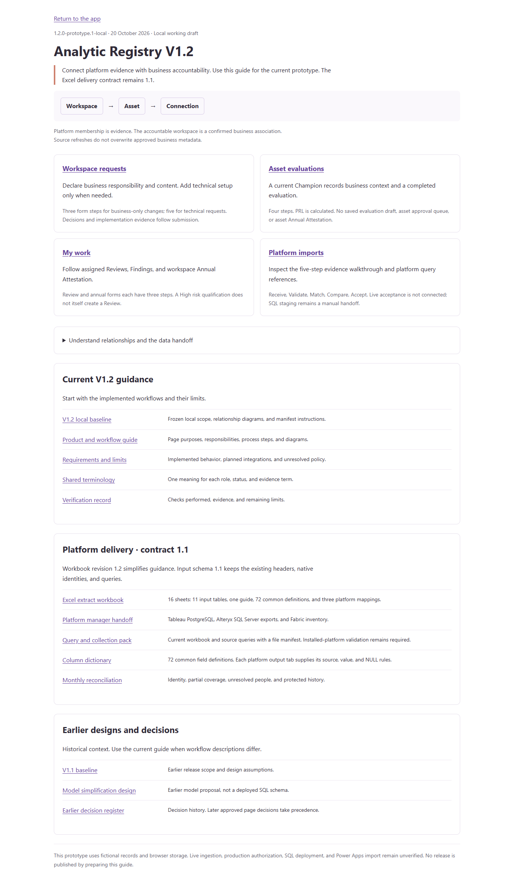
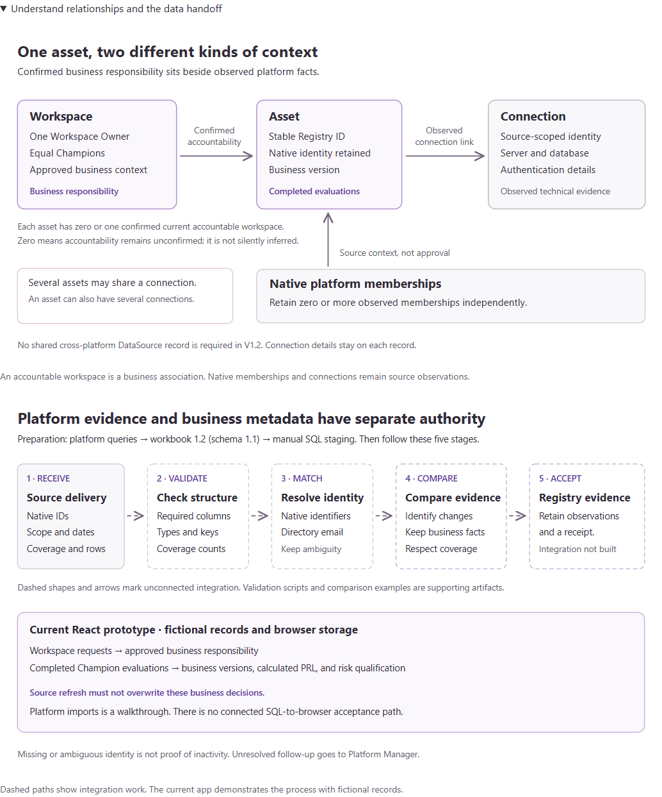

# V1.2 local verification

Historical local checks. See [publication verification](v1.2-publication-verification.md) for the release candidate.

20 October 2026. Local prototype `1.2.0-prototype.1-local`.

Start with the [current guide](v1.2-guide.md) and [requirements](v1.2-requirements.md).
Workbook revision 1.2 retains input schema 1.1. No live platform or Power Apps compatibility is claimed.

## Detection Coverage refinement — 21 October 2026

The local working copy now has one evidence catalog for all eleven risk buckets across four themes. The frozen baseline remains unchanged.
Current labels use V1.2. Input schema 1.1 and historical references retain their correct versions.

| Check | Result | Evidence |
|---|---|---|
| Application checks | 1,267 passed across 17 suites | [Application checks](verification/v1.2/coverage-risk-2026-10-21/application-checks-passed.txt) |
| Browser journeys | 101 passing assertions across five journeys; no browser runtime errors | [Browser results](verification/v1.2/coverage-risk-2026-10-21/browser-results.json) |
| TypeScript and local build | Passed; existing large-bundle warning remains | [Build log](verification/v1.2/coverage-risk-2026-10-21/build.txt) |
| Preservation | All 1,090 frozen files verified; eight protected data/policy files and workbook unchanged | [Preservation receipt](verification/v1.2/coverage-risk-2026-10-21/preservation.json) |
| Documentation command | 16 checks passed; current public guidance regenerated | Existing command fixtures plus current link validation |

Browser checks cover the eleven buckets, platform/theme filters, scoped finding links, visible finding status, and explicit Review-case navigation.
They check tablet width and unchanged stored records. Tests use isolated browser storage and an owned server; the user's port 5180 remains available.

The first administration run found an outdated test label after the guide changed “contract” to “input schema.”
The first work run read raw seed cases without applying normal startup migration.
It therefore missed the migrated finding-to-case relationships and used an unnecessary explicit-link fixture.
Four journeys passed in the full run; the repaired work journey passed on its own rerun.

### Verification skill follow-up

A later harness audit corrected state inspection to use the production decoder and seed migration.
The work journey now follows existing migrated links and checks that unlinked findings receive no inferred case links.
It uses no relationship fixture. Review and annual packet links, workspace navigation, and Administration menu links are exercised through visible controls.

The final [verification run](verification/v1.2/verification-skill-2026-10-21/run.json) passed all five journeys together with 104 assertions.
No browser runtime errors occurred. The owned server stopped, port 5191 was released, and evidence survived cleanup.
The runner now records its PID and command during startup, so interrupted runs can be identified safely.

The following sections retain the earlier baseline verification record. They are not a claim that the frozen baseline contains this later refinement.

## Review scope

Matt Pocock's architecture and domain-modeling skills identified duplicated documentation paths, stale release metadata, and historical wording presented as current.
The repair gives current documentation one catalog and one local preparation command.
The app and readable guide share workflow descriptions and release labels.
Earlier records and designs remain available with explicit historical status.

This directory is not a Git checkout. A local source snapshot is the review baseline.
The Standards and Spec reviews compare the final changes with that snapshot.

## Observed results

| Check | Result | Evidence |
|---|---|---|
| Application behavior | 1,155 checks passed across 15 suites | [Application checks](verification/v1.2/application-checks.txt) |
| Documentation command | 16 checks passed, including stale output, repeatability, and broken-link failure | [Documentation checks](verification/v1.2/documentation-checks.txt) |
| Local documentation links | All selected-document links resolved; stale public copies are rejected | [Documentation checks](verification/v1.2/documentation-checks.txt) |
| Browser workflows | 87 assertions passed across five feature areas; no runtime errors | [Browser results](verification/v1.2/browser-results.json) |
| Preservation and versions | 14 checks passed; eight protected source files and six historical bodies remain unchanged | [Preservation results](verification/v1.2/preservation.json) |
| TypeScript and local build | Passed; one bundle-size warning | [Build log](verification/v1.2/build.txt) |
| Revised workbook | 16 sheets, 11 unchanged input tables, 72 headers, and all platform reference cells verified | [Workbook validation](verification/v1.2/workbook-validation.json) |
| Collection packaging | Eight fixture checks passed, including source drift, public drift, and deterministic archive contents | [Packaging checks](verification/v1.2/packaging-checks.json) |
| Baseline command | 14 fixture assertions passed, including stale preview rejection and independent frozen verification | [Baseline checks](verification/v1.2/baseline-checks.json) |

Browser coverage includes workspaces, completed asset evaluations, requests, My work, and administration.
The new checks open App guide, follow Guide & documentation, and inspect the guide at 1366 by 768.
They verify all 13 resource links, compare the workbook and collection archive checksums, and confirm that reading documentation preserves registry records.
They expand both relationship diagrams and check image loading and horizontal overflow.
The existing current-workflows address resolves to the V1.2 guide text.

The final browser run passed 18 workspace, 15 asset, 15 request, 13 work, and 26 administration assertions.
It used fresh browser contexts and a separately owned server on port 5191.
Cleanup closed the test browser and released that port.
The user's port 5180 preview remained available.

The first browser run exposed a test timing error in Clear filters.
Its row count already matched before the checkbox finished rendering.
The repaired check waits for the URL, rows, and unchecked control together.
The failed run remains in the local scratch evidence; no product behavior changed to satisfy it.

## Standards review

**PASS. Zero documented-standard violations and zero actionable code-smell findings.**
The reviewer inspected the actual changes, documentation command, checksums, hooks, and test assertions.
See the [Standards report](verification/v1.2/standards-review.md).
The [extension review](verification/v1.2/extension-standards-review.md) covers the workbook, packaging, and baseline additions.

## Spec review

**PASS. Zero specification findings.**
The reviewer checked approved workflow invariants, current links, historical context, and implementation claims.
See the [Spec report](verification/v1.2/spec-review.md).
The [extension review](verification/v1.2/extension-spec-review.md) confirms the revised workbook and baseline remain within the agreed scope.

The two axes were reviewed independently using the configured inherited model.
This does not claim review across different model families.

## Repeat locally

1. Run `npm run docs:local` to prepare the current guide and selected document copies.
2. Run `npm run check:docs` to verify freshness, links, archive checksums, and command behavior.
3. Run `npm run check` for the application checks.
4. Run `npm run build:local` for TypeScript and the local build.
5. Use the project's verify-analytic-registry skill for disposable browser journeys.
6. Run `npm run check:resources` after the local build to verify served resources and checksums.
7. Run `npm run baseline:local` to create the frozen local snapshot.
8. Run `npm run check:baseline` to verify the frozen files without needing temporary build files.

Normal development and build hooks now prepare local documentation only.
The local command does not rebuild workbooks, query archives, historical diagrams, or registry data.
It omits links to private working notes from browser copies and marks them as local evidence.

## Remaining engineering work

The main JavaScript bundle is about 500.6 kB before compression and 149.3 kB with gzip.
Vite reports its 500 kB warning; the build succeeds. No measured runtime performance conclusion is claimed.

The current collection archive now has a source copy and a manifest of its exact contents.
The previous workbook remains unchanged. The revised workbook clarifies three purpose descriptions and preserves all input headers, types, keys, and platform rules.
The local documentation command hashes the exact configured workbook and archive.
Published release preparation is disabled for this local version and fails before mutation.

The workbook renderer/exporter returned exit code 1 after reporting successful output, without an error message.
All 16 sheets passed visual review. Independent saved-file validation passed with no formulas or Excel error cells.
The unexplained exporter exit remains recorded in the [workbook notes](verification/v1.2/workbook-notes.md). Native Excel was not tested.

Windows Node directory rename returned EPERM during baseline fixtures.
The command now uses a checked native Windows move when bounded retries fail, then verifies the saved manifest and every file.
The complete command passed the fixtures without manual finalization.

## Limits

Browser profiles simulate authority. They do not establish production authorization.
The platform import page remains a reference walkthrough.
Installed SQL queries, directory access, recurring imports, and Power Apps import remain unverified.
Annual policy, retirement operations, freshness thresholds, and shared-case rules remain unresolved where already recorded.
No new rule is inferred from the V1.2 label.
